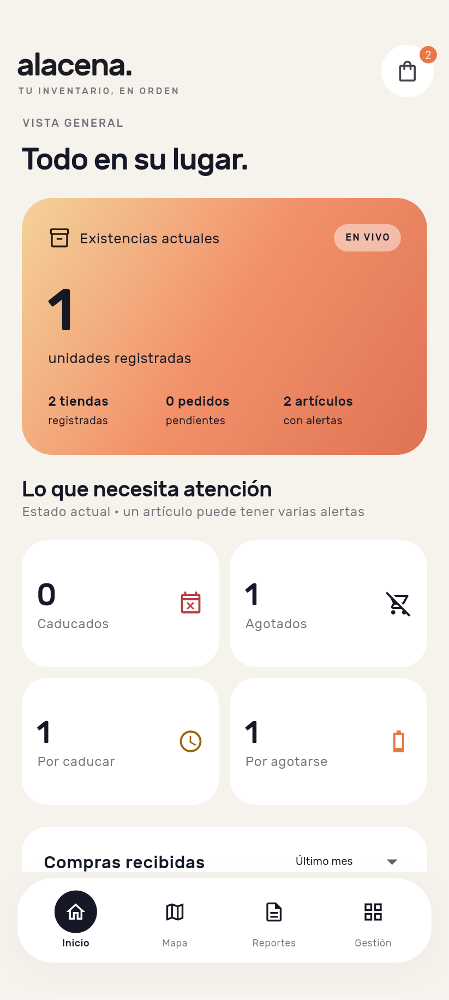
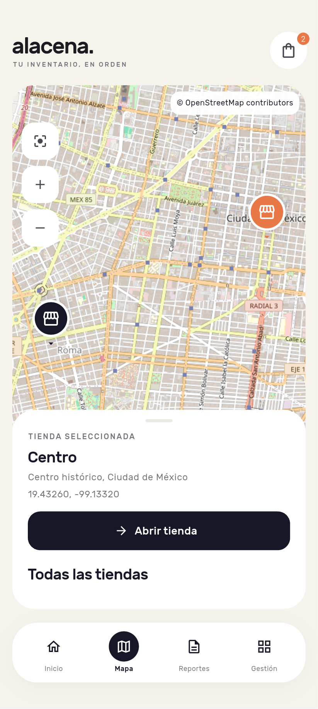
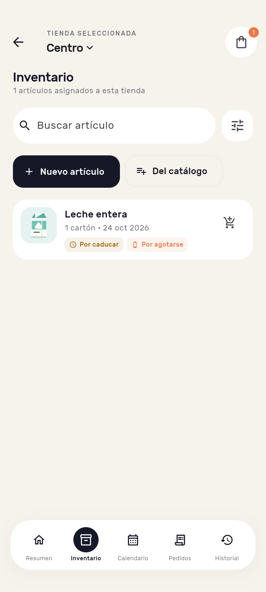

# Alacena

Inventario local para varias tiendas, con compras por proveedor, lotes, caducidad, consumo FEFO y reportes de trazabilidad. Aplicación Flutter con interfaz en español para Android y iOS.

Repositorio: [Esteban-Gonzalez-Cer/inventory](https://github.com/Esteban-Gonzalez-Cer/inventory).

Capturas reales del emulador Android con datos aislados de prueba:

<p>
  
  
  
</p>

## Funcionalidades

- Resumen global con estadísticas reales, tendencias de compras, sucursales y alertas prioritarias con imágenes.
- Espacio de cada tienda: Resumen, Inventario, Calendario, Pedidos e Historial. El selector de tienda permanece visible.
- CRUD de tiendas, categorías, proveedores y catálogo compartido; ilustraciones incluidas y fotografías del dispositivo.
- Asignación de productos con existencias, umbrales y avisos independientes por tienda.
- Alertas combinables: caducado, caduca hoy, por caducar, agotado y por agotarse; texto, color e icono.
- Lotes, consumo FEFO y descartes con motivo y referencias de origen.
- Carritos por tienda; pedidos a un proveedor, borradores, entregas parciales y cancelación de pendientes.
- Historial de compras, movimientos, eventos y proveedores de cada artículo, incluyendo última compra global y local.
- Calendario con un punto por artículo/fecha y un modal del día de pantalla completa.
- Recordatorios locales agrupados por fecha entre tiendas.
- Mapa OpenStreetMap con selección de marcadores, panel deslizable y ubicación manual.
- PDF por tienda o global, seis períodos móviles, guardado local, vista previa, impresión y compartir.

La aplicación inicia vacía. Los datos de las pruebas están aislados y no se cargan como inventario del usuario. No requiere cuenta ni servidor. **sqflite** conserva el inventario y sus operaciones; los datos son independientes en cada dispositivo.

## Ejecutar

Entorno utilizado: Flutter **3.47.5**, Dart **3.13.4**, Java 17. `pubspec.lock` fija las dependencias. Instala Flutter y el SDK Android, o Xcode completo para iOS.

```bash
git clone https://github.com/Esteban-Gonzalez-Cer/inventory.git
cd inventory
flutter pub get
flutter devices
flutter run -d <identificador-del-dispositivo>
```

Para generar el instalador de desarrollo Android:

```bash
flutter build apk --debug
```

Se guarda en `build/app/outputs/flutter-apk/app-debug.apk`. El proyecto conserva `com.example.inventory`; antes de una publicación comercial hay que definir identificadores propios y firma de distribución. La configuración release utiliza la firma de desarrollo.

Para iOS, el proyecto establece iOS **15.0** como mínimo y utiliza Swift Package Manager del SDK Flutter. Instala Xcode, sus componentes iOS y un simulador. Selecciona Xcode como directorio de desarrollo:

```bash
sudo xcode-select --switch /Applications/Xcode.app/Contents/Developer
sudo xcodebuild -runFirstLaunch
flutter doctor -v
flutter devices
flutter run -d <identificador-ios>
```

Para un iPhone físico configura también el equipo de firma en `ios/Runner.xcodeproj`. En el equipo de implementación solo están activas Command Line Tools: **la compilación y ejecución iOS requieren validación con Xcode completo**. El código multiplataforma y la compilación Android no sustituyen esa prueba.

## Primer recorrido

1. En **Gestión → Mis tiendas**, crea una sucursal con nombre, dirección y coordenadas. Puedes escoger su punto en el mapa.
2. Registra una **categoría** y un **proveedor**. Un proveedor es el establecimiento donde compras; una tienda es una sucursal que administras.
3. Entra a la tienda desde **Inicio** o **Mapa**. Su nombre permanece visible en la barra superior.
4. En **Inventario**, crea un artículo o asigna uno del catálogo. Inicia agotado; crearlo no registra existencias.
5. Agrégalo al carrito. El contador muestra artículos distintos; globalmente cuenta combinaciones tienda/artículo y agrupa la lista por tienda.
6. Crea un borrador, elige proveedor, cantidades y precios. Guarda y **envía el pedido**: retira del carrito las cantidades solicitadas y mantiene el inventario sin cambios.
7. Registra una **recepción** desde el pedido: cantidad realmente entregada, precio real y caducidad. Para fechas diferentes agrega grupos separados. Confirmar aumenta las existencias.
8. En el detalle del artículo consulta lotes, consume o descarta. Los lotes vencidos con unidades deben descartarse antes de consumir.
9. Consulta **Calendario** e **Historial**. Toca el nombre de la tienda para cambiarla; sus operaciones comienzan de nuevo en Resumen.
10. En **Reportes**, elige alcance y período. **Generar y ver PDF** guarda una copia fija y abre la vista previa para imprimir o compartir.

En **Gestión → Configurar recordatorios**, habilita las notificaciones y elige la hora local. Cada artículo/tienda permite cambiar umbrales y desactivar avisos.

## Reglas y estadísticas

Cantidades enteras; costos en centavos enteros de MXN. Valores iniciales por artículo/tienda: mínimo **2 unidades**, aviso **7 días**, recordatorios habilitados.

Stock = suma de `Lote.cantidad`, incluyendo unidades vencidas hasta descartarlas. Cero o ausencia de lotes significa **Agotado**. **Por agotarse** significa stock positivo menor o igual al mínimo. Las alertas de fecha solo consideran lotes con unidades. Se pueden registrar artículos sin caducidad.

FEFO consume dentro de una tienda: primero caducidad más próxima, empates por ID y lotes sin fecha al final. Si hay vencidos, exige descartarlos. Un consumo excesivo se rechaza sin cambios parciales. Caducar hoy no equivale a estar vencido: vence al cambiar el día local.

```text
Carrito → Borrador → Pedido → Parcialmente recibido → Recibido
                         ↘ Cancelado (cantidades pendientes)
```

Cada pedido tiene una sucursal y un proveedor. Las recepciones no superan lo pendiente. Un identificador único evita duplicar una confirmación repetida; reutilizarlo con datos diferentes se rechaza. Recepciones y consumos completos se ejecutan en transacciones.

Cancelar pendientes conserva compras y lotes recibidos. Solo se editan/eliminan borradores. Los maestros referenciados se protegen con claves foráneas; compras y movimientos conservan su historial. La inserción de compras actualiza `Producto.ultima_tienda_id` y el último proveedor de `ProductoSucursal` mediante un disparador. Los nombres históricos se copian a las operaciones para conservar su trazabilidad si luego se renombra el catálogo.

| Indicador | Definición |
|---|---|
| Tiendas | Sucursales registradas |
| Catálogo | Productos compartidos distintos |
| Unidades registradas | Restante de los lotes, incluidos vencidos hasta descartarlos |
| Alertas | Combinaciones tienda/producto; un producto puede tener varios estados |
| Compras recibidas | Cantidad recibida × costo real dentro del período |
| Pedidos pendientes | Pedidos enviados/parciales con cantidades por recibir |

Las existencias son una fotografía actual. El gráfico de compras reparte el período seleccionado en siete intervalos con recepciones reales; no representa ventas ni pronósticos.

## Calendario y recordatorios

El calendario es específico de la tienda. Hoy muestra alertas activas; las fechas futuras muestran ventanas de aviso y caducidad; las anteriores muestran caducidades de lotes todavía existentes. Un artículo genera un punto por fecha aunque tenga varios lotes. El modal presenta cada producto una vez y sus lotes relevantes con cantidades actuales. No reconstruye stock histórico ni predice fechas de agotamiento.

`Lote.fecha_alarma` se guarda igual a su caducidad. Se agrupan avisos entre tiendas, uno por fecha, hasta **60 fechas**. Se reconstruyen al cambiar inventario y al iniciar/reanudar la app. Android usa alarmas inexactas sin solicitar permiso de alarmas exactas; permisos, batería y sistema pueden ajustar su entrega. Al tocar un aviso se abre el día con artículos que caducan y sus tiendas.

## Mapa y uso sin conexión

`flutter_map` usa OpenStreetMap. Las ubicaciones se guardan en SQLite. Tocar un marcador selecciona su panel; **Abrir tienda** entra a sus operaciones. También hay selección mediante la lista de tiendas.

Se muestra atribución visible, se identifica la aplicación en las solicitudes y se usa la caché del paquete respetando encabezados, con límite de 100 MB. No se descargan zonas completas. Sin conexión permanecen disponibles inventario, direcciones, coordenadas y selección; las teselas requieren conexión o caché previa. No incluye geocodificación, autocompletado ni seguimiento GPS.

## PDF y períodos

Cada reporte congela una sola hora y los datos antes de generarse. Vista previa, impresión, archivo y compartir utilizan los mismos bytes. Las fuentes están incluidas para generar sin conexión.

| Opción | Intervalo anterior a la generación |
|---|---|
| Último día | 24 horas |
| Última semana | 7 días |
| Último mes | 1 mes calendario |
| Últimos 3 meses | 3 meses calendario |
| Últimos 6 meses | 6 meses calendario |
| Último año | 12 meses calendario |

La resta de meses conserva hora local y ajusta al último día válido: 31 de marzo de 2024 → 29 de febrero. Inicio incluido y final excluido. Se guardan eventos UTC y el documento imprime límites locales exactos y zona del dispositivo.

Incluye alcance, referencia, pedidos relacionados, artículos solicitados, recepciones, proveedores, lotes, consumos, descartes y eventos. Los pedidos anteriores aparecen como contexto cuando tienen actividad incluida. El gasto cuenta solo recepciones del intervalo; el valor solicitado se indica como contexto. Tablas con encabezados repetidos y páginas numeradas.

Los PDF se guardan en documentos privados de la app, carpeta `reportes`, con metadatos en `ReporteExportado`. Usa Compartir para conservar una copia externa. Desinstalar la app puede eliminar los datos locales.

## Código y base de datos

```text
lib/app.dart         Navegación y ciclo de vida
lib/core/            Controlador, moneda, fechas y errores
lib/data/            Apertura sqflite y repositorio transaccional
lib/domain/          Modelos, alertas y períodos
lib/services/        Recordatorios y PDF
lib/ui/              Pantallas, formularios y tema
assets/sql/          Esquema SQL ejecutable
assets/products/     Seis ilustraciones SVG originales
assets/fonts/        Rubik y licencia OFL
test/                Reglas, SQLite, reportes y widgets
integration_test/    Comprobaciones nativas en dispositivo
```

`alacena.db` se crea automáticamente con esquema versión 1 y `PRAGMA foreign_keys=ON`. El [SQL](assets/sql/001_schema.sql) es la fuente ejecutable; no requiere instalación manual. Las relaciones compuestas mantienen tienda/artículo/pedido/lote consistentes. Hay índices de fechas/FEFO y disparadores que protegen historial y proveedores. Las futuras versiones requieren migraciones explícitas: no se borran datos silenciosamente.

El repositorio exige sucursal en todas las mutaciones operativas. El controlador publica una fotografía coherente, ignora respuestas antiguas y bloquea mutaciones simultáneas. Consulta [DATABASE.md](docs/DATABASE.md) y [ACCEPTANCE.md](docs/ACCEPTANCE.md).

La [documentación del desarrollo paso a paso](docs/DESARROLLO_APLICACION.md) explica la construcción por archivos, con énfasis en SQLite, transacciones, FEFO y trazabilidad, ejemplos de código y resultados de verificación.

## Verificación

```bash
flutter analyze --no-pub
flutter test --no-pub
flutter test integration_test/device_test.dart -d <dispositivo>
flutter build apk --debug
```

Para guardar capturas nativas en `build/qa/`:

```bash
flutter drive --driver=test_driver/device_driver.dart --target=integration_test/device_test.dart -d <dispositivo>
```

Las pruebas locales usan SQLite real con `sqflite_common_ffi`, bases aisladas y reloj controlado. Cubren FEFO, rechazo atómico, vencidos, separación de tiendas, recepciones, duplicados, cancelación, proveedores, restricciones, persistencia, períodos y PDF, calendario, navegación y pantallas estrechas. Los PDF de prueba se generan en `build/qa/`, ignorado por Git.

La prueba nativa crea una base temporal independiente; no modifica `alacena.db`. Comprueba reapertura, entregas parciales, FEFO, recordatorios pendientes, marcadores y renderizado PDF. Puede cancelar recordatorios de esa instalación: úsala en un emulador o instalación dedicada. El estado verificado y pruebas manuales pendientes están en [ACCEPTANCE.md](docs/ACCEPTANCE.md).

## Requisitos de la práctica

| Requisito | Implementación |
|---|---|
| Persistencia | sqflite, restricciones y transacciones |
| Alertas con imágenes | Resumen global, de tienda y modal |
| Calendario y puntos | table_calendar, un punto por artículo/fecha |
| Modal completo | Dialog.fullscreen y lista Sliver |
| Estados | Texto, iconos y colores |
| Categorías y CRUD | Gestión y asignación por sucursal |
| Carrito con contador | badges, conteo por tienda o global agrupado |
| FEFO y agotado | Motor por lotes |
| Trazabilidad | Historial y ultima_tienda_id global/local |
| Alarmas | fecha_alarma, permisos y apertura del día |
| Slivers | CustomScrollView, SliverList, SliverGrid |
| Widgets adicionales | SearchAnchor y DraggableScrollableSheet |
| Función extra | Varias tiendas, mapa, pedidos parciales, PDF y registro de desperdicio |
| Creatividad | Tema, ilustraciones, paneles y navegación propios |
| Entrega | GitHub, APK de desarrollo y guía de presentación |

## Alcance y créditos

No incluye ventas, usuarios, sincronización, traspasos, pronósticos ni respaldos automáticos. Un PDF es trazabilidad, no una copia restaurable de SQLite. No se necesita permiso de ubicación para colocar un punto manual.

Rubik utiliza [SIL Open Font License](assets/fonts/OFL.txt). Mapas: [© OpenStreetMap contributors](https://www.openstreetmap.org/copyright) y [política de teselas](https://operations.osmfoundation.org/policies/tiles/). Paquetes principales: [sqflite](https://pub.dev/packages/sqflite), [table_calendar](https://pub.dev/packages/table_calendar), [badges](https://pub.dev/packages/badges), [flutter_map](https://pub.dev/packages/flutter_map), [flutter_local_notifications](https://pub.dev/packages/flutter_local_notifications), [pdf](https://pub.dev/packages/pdf) y [printing](https://pub.dev/packages/printing).
