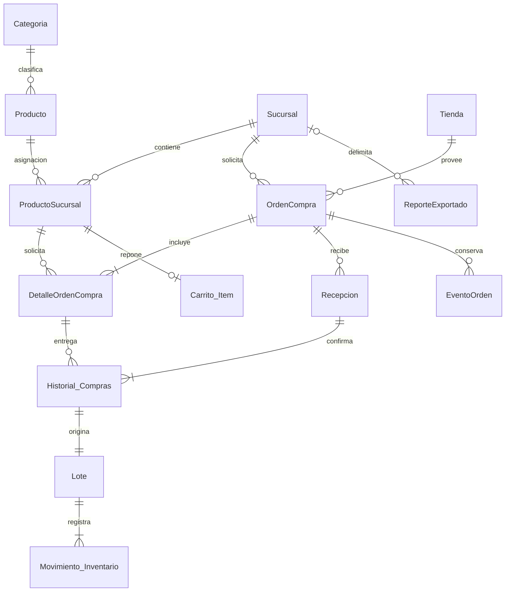

# Modelo e integridad

[`001_schema.sql`](../assets/sql/001_schema.sql) es el esquema ejecutable versión 1. `AppDatabase.open()` activa las claves foráneas y lo ejecuta al crear la base. Los delimitadores separan sentencias completas, incluidos disparadores.



`Sucursal` es una tienda administrada. `Tienda` conserva el nombre de la práctica para los establecimientos de compra y se presenta como **Proveedor**. `Producto` y `Categoria` son globales. `ProductoSucursal` identifica la combinación única y guarda umbrales, avisos y último proveedor local.

| Tabla | Responsabilidad |
|---|---|
| Sucursal | Nombre único, dirección obligatoria y coordenadas válidas |
| Tienda / Categoria | Maestros con nombre único |
| Producto | Categoría, unidad, imagen y último proveedor global |
| ProductoSucursal | Asignación única, mínimo ≥0, aviso 0–365, recordatorios 0/1 |
| OrdenCompra | Sucursal, proveedor, estado y nombres históricos |
| DetalleOrdenCompra | Cantidad solicitada, precio y producto de esa sucursal |
| Recepcion | Identificador de operación único y firma del contenido |
| Historial_Compras | Cantidades/costos reales con referencias a recepción, detalle, producto y proveedor |
| Lote | Compra de origen, cantidad inicial/restante, caducidad y alarma |
| Carrito_Item | Cantidad por artículo/sucursal |
| Movimiento_Inventario | Recepción, consumo o descarte con lote, fecha y motivo |
| EventoOrden | Transiciones y ediciones del pedido |
| ReporteExportado | Archivo, referencia, alcance, zona y límites exactos |
| Configuracion | Hora/minuto de avisos |

Cantidades y precios exigen tipo entero; cantidades operativas positivas y precios no negativos. Un lote mantiene su cantidad entre cero y la original. La aplicación normaliza caducidades con DateTime; los eventos son ISO UTC y las fechas de lote son YYYY-MM-DD local.

Las claves compuestas impiden asociar una recepción o movimiento a otra tienda/producto. Los maestros y operaciones confirmadas usan `RESTRICT`; las compras y movimientos tienen disparadores contra edición/eliminación. El borrado en cascada se limita a componentes de pedidos borrables; el repositorio solo permite borrar borradores. Las asignaciones referenciadas no se pueden retirar.

## Transacciones

**Recepción:** validar estado/pertenencia → comprobar operación previa → sumar recibido por detalle → rechazar exceso → crear recepción, compras, lotes y movimientos → actualizar estado → registrar evento. El disparador de compras actualiza los dos últimos proveedores dentro de la misma transacción. Repetir idéntica operación devuelve su recepción original.

**Consumo:** validar sucursal/artículo → cargar lotes positivos por FEFO → rechazar vencidos → comprobar disponibilidad total → descontar y registrar cada lote. Cualquier fallo revierte todo.

**Descarte:** validar pertenencia, cantidad y motivo → descontar lote → guardar movimiento. El lote permanece para auditoría aunque llegue a cero.

**Envío:** validar borrador → cambiar estado → retirar cantidades del carrito conservando cualquier exceso → guardar evento. No crea stock.

**Cancelación:** validar estado → cancelar pendientes y guardar motivo/evento. Conserva compras y lotes anteriores.

**Lectura y reportes:** carga coherente dentro de una transacción; el PDF congela filas de esa fotografía antes de generar sus bytes.

## Consultas de referencia

```sql
-- Stock de una asignación
SELECT COALESCE(SUM(cantidad), 0) AS stock FROM Lote
WHERE branch_id = ? AND branch_product_id = ? AND cantidad > 0;

-- Orden FEFO; los no perecederos quedan al final
SELECT * FROM Lote
WHERE branch_id = ? AND branch_product_id = ? AND cantidad > 0
ORDER BY expiry_date IS NULL, expiry_date, id;

-- Todos los establecimientos donde se ha comprado un producto
SELECT DISTINCT t.id, t.name FROM Historial_Compras h
JOIN Tienda t ON t.id = h.supplier_id WHERE h.product_id = ?;

-- Gasto recibido en una sucursal, inicio incluido y fin excluido
SELECT COALESCE(SUM(quantity * unit_cost), 0) AS received_cents
FROM Historial_Compras
WHERE branch_id = ? AND created_at >= ? AND created_at < ?;
```

No se almacena un total paralelo de stock. Las consultas operativas exigen sucursal; el alcance global del resumen/reportes es explícito. La siguiente versión del esquema debe incorporar una migración real; no se eliminan tablas como estrategia de actualización.
